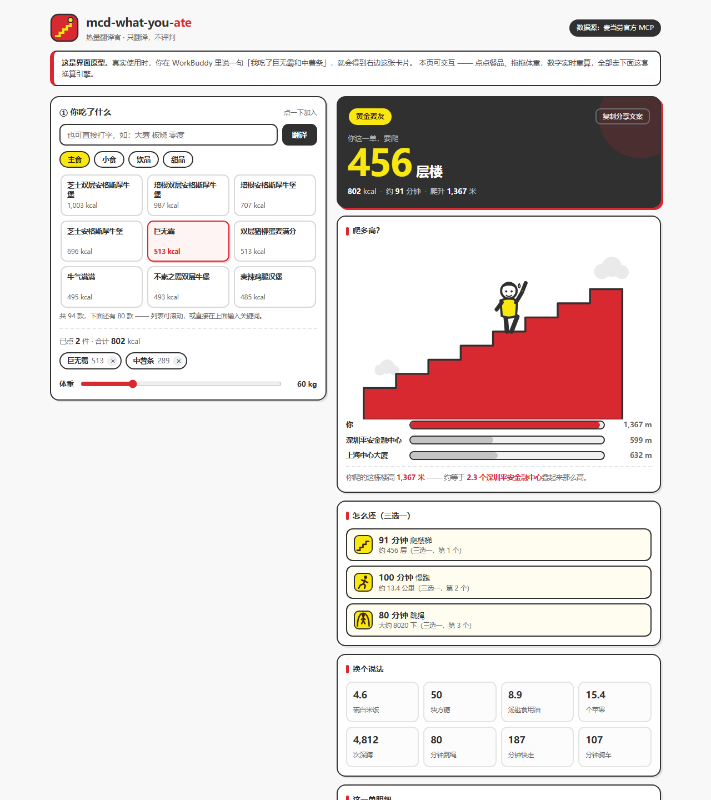
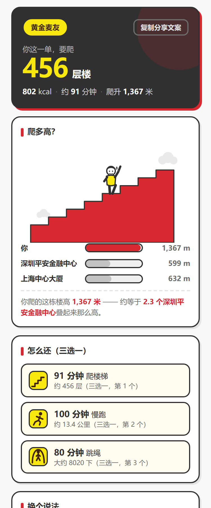

<picture>
  
</picture>

# mcd-what-you-ate

**你这一顿，到底吃了什么？**

把麦当劳的热量，翻译成「要爬多少层楼」。

---

## 这是什么

一个基于**麦当劳官方 MCP** 开发的 WorkBuddy Skill。

你告诉它你吃了什么，它把总热量翻译成一组你能立刻感知的当量：

```
你：我中午吃了巨无霸 + 中薯条

它：
> 802 kcal —— 段位：黄金麦友
> 🏢 要爬 456 层楼（约 91 分钟，爬升 1367 米）
> 🏃 或者跑步 100 分钟
> 🦵 或者深蹲 4812 次
> 🍚 或者 4.6 碗白米饭 / 50 块方糖 / 8.9 汤匙油
>
> 📐 你爬的这栋楼高 1367 米 —— 约等于 2 个深圳平安金融中心叠起来那么高
```

**关键点：所有数字都是真的。** 热量来自麦当劳 MCP 的 `list-nutrition-foods` 接口，运动当量按公开的 MET（代谢当量）值换算。荒诞感不靠编造，靠的是把准确数据换成一个荒谬的单位。

## 先看效果：可交互 Demo

打开 [`index.html`](./index.html) 就能玩 —— **单文件、零依赖、离线可跑**，双击即开。



它不是一张截图，是真的能点：

| 你操作 | 它反应 |
|---|---|
| 点一个餐品 | 层数、段位、还债方案实时重算 |
| 拖体重滑块 | 运动当量随之变化（体重越大，还债越快）|
| 输入「大薯 板烧 零度」 | 走别名引擎，解析成官方商品名 |
| 输错一个字 | 明确告诉你「没认出来」，不静默吞掉 |

手机上同样验证过（375px 宽，无横向滚动）：



> 真实使用时**不需要**打开这个页面。你在 WorkBuddy 里说一句「我吃了巨无霸和中薯条」，得到的就是上面那张卡片。
> Demo 存在的意义是让评委和用户**直接看见**产品长什么样 —— 而不是只能靠想象。
>
> 界面里的所有数字由 `index.html` 内嵌的 JS 引擎算出，与 `scripts/calorie_engine.py` 逐项对齐，
> 用 `node scripts/verify_demo.js` 可以一键校验（24 项基准全绿才算通过）。


## 它不做什么

这一点很重要：

- ❌ 不告诉你"这个太胖了别吃"
- ❌ 不给你制造负罪感
- ❌ 不跟任何其他品牌做对比

它只做一件事：**翻译**。翻译完之后，永远给你三个可执行的运动出口（"怎么还"），而不是一句审判。

## 目标用户

| 人群 | 他们的痛点 |
|---|---|
| **健身 / 减脂人群** | 想知道"今天这顿要还多少"，但懒得自己算 |
| **麦当劳常客（"麦门"）** | 顿顿吃，但对自己的摄入完全没有概念 |
| **被热量数字麻木的人** | 看到"513 kcal"没感觉，看到"要爬 291 层楼"瞬间有感觉 |
| **爱分享的年轻人** | 段位系统 + 荒诞数字，天然适合截图发朋友圈 |
| **需要饮食记录的轻度用户** | 不想装 App、不想记卡路里，只想问一句"刚吃的这顿算多吗" |

## 安装

### 前置条件

1. 一个麦当劳中国 MCP Token —— 去 https://open.mcd.cn/mcp 手机号登录，在控制台点「激活」获取
2. WorkBuddy（本项目使用 WorkBuddy 开发，并参与其专项奖励）

### 第一步：配置 MCP 连接器

打开 WorkBuddy → 左侧边栏【专家·技能·连接器】→【连接器】页签 → 右上角【自定义连接器】→【配置 MCP】，填入：

```json
{
  "mcpServers": {
    "mcd-mcp": {
      "type": "streamablehttp",
      "url": "https://mcp.mcd.cn",
      "headers": {
        "Authorization": "Bearer YOUR_MCP_TOKEN"
      }
    }
  }
}
```

> ⚠️ 把 `YOUR_MCP_TOKEN` 替换成你自己的 Token，保存后回到【自定义连接器】把 `mcd-mcp` 启用。

> 脱敏后的配置示例见本仓库 [`mcp-config.example.json`](./mcp-config.example.json)，其中只使用环境变量占位符。

### 第二步：安装本 Skill

把本目录放入 WorkBuddy 的 skills 目录：

```bash
# 用户级（所有项目可用）
cp -r mcd-what-you-ate ~/.workbuddy/skills/

# 或项目级
cp -r mcd-what-you-ate <你的项目>/.workbuddy/skills/
```

### 第三步：验证

```bash
# 能打印出账单即安装成功
python scripts/calorie_engine.py 巨无霸 中薯条

# 自检：数据一致性 + 边界安全 + 5 项基准防回归（12 项全绿才算完成）
python scripts/calorie_engine.py --doctor

# 对抗性压力测试：极端参数、空输入、畸形输入（退出码非 0 = 有问题）
python scripts/stress_test.py

# 跨语言一致性：Demo 内嵌的 JS 引擎 vs Python 引擎（24 项，需 node）
node scripts/verify_demo.js
```

`--doctor` 是本项目的质量门禁。营养库是官方接口的快照，别名表是人工维护的，
两者一旦不同步，用户就会拿到**错误但看起来完全正常**的热量 —— 自检把这类静默错误变成显式失败。

`stress_test.py` 是它的补充：自检只覆盖已知基准，压力测试负责**去发现未知的**软肋。
本项目的两个真实缺陷（空输入被静默解析成一款商品、`--weight 0` 除零崩溃）都是它一次跑出来的，
修复后已固化为 `--doctor` 的永久检查项。

## 使用示例

### 示例 1：问一顿饭欠了多少

```
> 我今天中午吃了麦辣鸡腿汉堡和一份大薯

输出：
> 864 kcal —— 段位：黄金麦友
> 🏢 要爬 491 层楼（约 98 分钟，爬升 1473 米）
> ...
```

### 示例 2：换个体重算

```
python scripts/calorie_engine.py 巨无霸 --weight 75
```

运动当量随体重线性变化——体重越大，同样热量需要的运动时间越短。

### 示例 3：直接给总热量

```
python scripts/calorie_engine.py --kcal 1003
```

### 示例 4：查营养库里有什么

```
python scripts/calorie_engine.py --list
```

### 示例 5：机器可读输出（供二次开发）

```
python scripts/calorie_engine.py 巨无霸 --json
```

## 段位系统

| 单次摄入 | 段位 |
|---|---|
| < 300 kcal | 青铜麦友 |
| 300 – 599 kcal | 白银麦友 |
| 600 – 899 kcal | 黄金麦友 |
| 900 – 1299 kcal | 铂金麦友 |
| 1300 – 1999 kcal | 钻石麦友 |
| ≥ 2000 kcal | 王者巨无霸 |

## 换算基准

全部系数公开可复算：

| 项目 | 基准值 |
|---|---|
| 体重 | 默认 60kg（可用 `--weight` 调整） |
| 爬楼梯 | 8.8 MET；一层楼 3 米，约 12 秒 |
| 跑步 | 8.0 MET |
| 跳绳 | 10.0 MET |
| 深蹲 | 5.0 MET，约 30 次/分钟 |
| 快走 | 4.3 MET |
| 骑车 | 7.5 MET |
| 白米饭 | 174 kcal / 碗（150g 熟饭） |
| 方糖 | 16 kcal / 块（4g） |
| 食用油 | 90 kcal / 汤匙（10g） |
| 苹果 | 52 kcal / 个（100g 可食部） |

计算方法：`1 MET ≈ 1 kcal / (kg × 小时)`，因此 `每分钟消耗 = MET × 体重kg / 60`。

## 项目结构

```
mcd-what-you-ate/
├── index.html                  # 可交互 Demo（单文件、零依赖、离线可跑）
├── SKILL.md                    # WorkBuddy Skill 定义
├── README.md                   # 本文档
├── CHANGELOG.md                # 迭代记录（含三个已修复的静默计算错误）
├── CONTEST_DECLARATION.md      # 参赛声明（官方原版，未作任何修改）
├── MCP_INTEGRATION.md          # MCP 集成说明
├── mcp-config.example.json     # 脱敏配置示例（仅环境变量占位符）
├── workbuddy.md                # WorkBuddy 开发对话上下文
├── scripts/
│   ├── calorie_engine.py       # 换算引擎（无第三方依赖）
│   ├── stress_test.py          # 对抗性压力测试（边界 / 畸形输入 / 全库渲染）
│   ├── build_demo.py           # 把营养库快照注入 index.html
│   └── verify_demo.js          # 校验 Demo 内嵌引擎与 Python 引擎逐项一致
├── data/
│   └── nutrition_raw.csv       # 官方营养库快照（158 条 SKU）
└── assets/
    ├── ip-climb-stairs-v2.0.png
    ├── demo-desktop.png
    └── demo-mobile.png
```

## MCP 使用情况

本 Skill 真实调用麦当劳 MCP 的以下 Tool（均为只读）：

| Tool | 用途 |
|---|---|
| `list-nutrition-foods` | 餐品营养成分（**热量唯一来源**） |
| `query-meals` | 门店在售菜单与价格 |
| `query-nearby-stores` | 附近门店 |
| `query-store-coupons` | 门店可用券 |
| `now-time-info` | 服务端时间（判断时段） |
| `campaign-calendar` | 当月活动 |

详细调用流程、参数传递规则与开发中发现的三个数据特性，见 [`MCP_INTEGRATION.md`](./MCP_INTEGRATION.md)。

## 依赖

- Python 3.8+
- **无任何第三方依赖**（仅标准库）

## 免责声明

本 Skill 为麦当劳程序员节创意开发大赛参赛作品，由参赛者独立开发，非麦当劳官方产品。

输出结果仅作运动量参考，**不构成医疗、营养或其他专业建议**。餐品信息、价格及供应状态以麦当劳官方渠道的实时结果为准。

热量数据来自麦当劳 MCP 官方接口，运动当量按公开 MET 值换算，仅供娱乐与自我管理参考。
